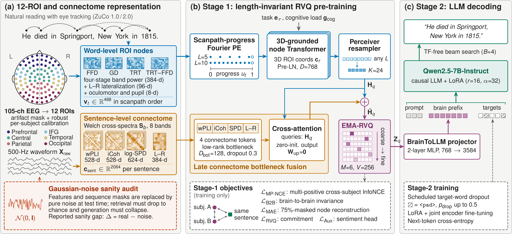
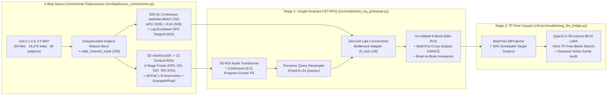

# RUSH-EEG2Text: Riemannian Connectome-Guided Hierarchical Quantization for Teacher-Forcing-Free Cross-Subject EEG-to-Text Decoding

[-00629B)](./paper_q1/RUSH_EEG2Text_IEEE_TNSRE_Draft.pdf)
[](https://huggingface.co/RUSH0100/RUSH-EEG2Text-Qwen2.5-7B)
[-76B900)](./configs/spark_full4task_champion_qwen7b.yaml)
[](./paper_q1/COLLABORATION_NOTE_HIT_SHENZHEN.md)
[](./assets/rush-eeg2text-explained-simply.mp4)
[](./LICENSE)

> **Pre-Submission Working Draft & Academic Collaboration Proposal:**  
> **Prepared under the KMITL Doctoral Scholarship Overseas Research Mobility Grant (400,000 THB / ~82,000 RMB)**  
> **Target Visiting Research Institution:** Harbin Institute of Technology, Shenzhen (HIT Shenzhen, China)  
> 
> - **Lead Researchers:**  
>   - **Ratchaphon Khaemphukhiao** *(Lead Ph.D. Researcher, Dept. of Biomedical Engineering, KMITL)*  
>   - **Assoc. Prof. Pattarapong Phasukkit, D.Eng.** *(Advisor & Principal Corresponding Author, Dept. of Electronic Engineering, KMITL)*  
> - **Invited Co-Author Slots (Open for Joint Research Collaboration):**  
>   - `[Invited Co-Author Slot: Dr. Zhenxi Song, Harbin Institute of Technology, Shenzhen]`  
>   - `[Invited Co-Author & Co-Corresponding Author Slot: Prof. Zhiguo Zhang, Harbin Institute of Technology, Shenzhen]`  
> - **Status:** Fully reproducible prototype & pre-submission manuscript draft submitted as an academic invitation to collaborate during an upcoming visiting research stay.  
> - **Manuscript Draft (IEEE Double-Column PDF):** [`paper_q1/RUSH_EEG2Text_IEEE_TNSRE_Draft.pdf`](./paper_q1/RUSH_EEG2Text_IEEE_TNSRE_Draft.pdf)  
> - **Conceptual Video Explainer:** [`assets/rush-eeg2text-explained-simply.mp4`](./assets/rush-eeg2text-explained-simply.mp4)

---

### 🎥 Executive Video Presentation & Plain-Language Explainer
A plain-language audio-visual explainer walking through the motivation, Riemannian connectome mapping, length-leakage elimination, and non-teacher-forced LLM decoding:
- **Local File in Repository:** [`assets/rush-eeg2text-explained-simply.mp4`](./assets/rush-eeg2text-explained-simply.mp4)
- **Direct GitHub Video Link:** [Click to view / download video (`assets/rush-eeg2text-explained-simply.mp4`)](https://github.com/rush0100/RUSH-EEG2Text/raw/main/assets/rush-eeg2text-explained-simply.mp4)

---

---

## 1. Scientific Motivation & Direct Connection to HIT Shenzhen BCI Lab

Recent breakthroughs in open-vocabulary brain-to-text decoding—specifically **[CET-MAE (Wang, Song, Zhang et al., ACL 2024)](https://aclanthology.org/2024.acl-long.393.pdf)** and **[BrainECHO (Li, Song, Zhang et al., Findings of ACL 2025)](https://aclanthology.org/2025.findings-acl.142/)**—established self-supervised masked EEG-text alignment and vector-quantized noise suppression. However, three open challenges remain in silent natural-reading / text-evoked EEG decoding (explicitly highlighted in *BrainECHO* Section 5 and *Jo et al., 2024*):

1. **Implicit Signal-Length / Fixation-Count Leakage:** Standard integer positional encodings (`0, 1, ..., L-1`) leak the number of fixated words through attention masks—allowing pure Gaussian noise $\mathcal{N}(0, \mathbf{I})$ to achieve **$3.2\times$ random-chance** retrieval accuracy (`5.29%` vs. `1.64%`).
2. **Lack of Acoustic Intermediate Targets in Silent Reading:** Unlike speech-listening EEG/MEG where Mel spectrograms provide discrete VQ targets for Whisper (*BrainECHO*), silent reading requires discretizing cortical representations directly without **VQ codebook collapse**.
3. **Cross-Subject Covariate Shift in Flat 840-d Vectors:** Flattening 105 scalp channels from a single eye-fixation window (`GD`) discards 3D cortical geometry, chronological eye-regression scanpaths (`FFD -> GD -> TRT`), phase-lagged functional connectivity (`wPLI`, `iCoh`), and Riemannian SPD covariance geometry (*EEG-MACS, Song & Zhang et al., ACM MM 2024*).

**RUSH-EEG2Text** resolves all three bottlenecks end-to-end on a single desktop **NVIDIA DGX Spark** (GB10 Grace Blackwell Superchip, 128 GB coherent unified memory).

---

## 2. Architecture Overview



*Figure 1: Complete end-to-end architecture of RUSH-EEG2Text: (a) 12-ROI & Riemannian connectome representation; (b) Stage 1 length-invariant EMA-RVQ pre-training with zero-leakage progress Fourier positional encoding; (c) Stage 2 teacher-forcing-free causal LLM decoding with Qwen2.5-7B-Instruct.*



---

## 3. Key Empirical Results (Strict Unseen-Subject Split)

### A. Controlled 14-Run Stage 1 Ablation (`ZuCo 1.0 task1-SR`, 400-Sentence Bank, Unseen Test Subject `ZMG`)
Full logs & configurations: [`logs/stage1_connectome_leaderboard.json`](./logs/stage1_connectome_leaderboard.json)

| ID | Stage 1 Architecture & Representation | Val (`ZJS`) MRR | Test (`ZMG`) R@1 | Test (`ZMG`) R@5 | Test (`ZMG`) R@10 | Test (`ZMG`) MRR | $\mathcal{N}(0,\mathbf{I})$ Noise MRR | Neural Sanity Gap ($\Delta$MRR) |
| :--- | :--- | :---: | :---: | :---: | :---: | :---: | :---: | :---: |
| — | *Theoretical 400-Way Random Chance* | 1.64% | 0.25% | 1.25% | 2.50% | 1.64% | 1.64% | 0.00% |
| `R0` | Flat 840-d GD + Integer PE + Single-Pos InfoNCE | 7.87% | 2.08% | 7.79% | 12.73% | 6.40% | *5.29%* (Leaked) | +1.11% |
| `R1a` | Flat 840-d GD + **Continuous `[0,1]` PE** + Multi-Pos InfoNCE | 14.23% | 4.40% | 14.77% | 26.94% | 10.52% | **1.55%** (Fixed) | +8.97% |
| `R1b` | Edge & Connectome Stream Only (`wPLI` + `iCoh` + `SPD`) | 11.23% | 4.40% | 15.03% | 23.83% | 11.34% | 1.91% | +9.43% |
| `R1c` | Early Token-Level Gated Dual-Stream Fusion | 14.94% | 6.48% | 21.76% | 33.94% | 14.94% | 1.54% | +13.40% |
| `R1d` | **3D 12-ROI 4-Stage Node Stream** (`FFD/GD/TRT` + Gaze) | 21.01% | 10.62% | 28.76% | 40.93% | 20.18% | 1.60% | +18.58% |
| **`R5c`** | **RUSH-EEG2Text (`3D 12-ROI` + `Late Connectome Bottleneck` + `6-Book EMA-RVQ`)** | **23.00%** | **12.18%** | **30.83%** | **44.30%** | **22.22%** | **1.42%** | **+20.80%** |

### B. Full-Scale Multi-Corpus Stage 1 (`ZuCo 1.0 + ZuCo 2.0`, All 4 Tasks, 18,276 Trials, 30 Unique Subjects)
Full summary JSON: [`logs/rush_eeg2text_full4task_champion_qwen7b/stage1_summary.json`](./logs/rush_eeg2text_full4task_champion_qwen7b/stage1_summary.json)

Evaluated zero-shot across **1,313 unique sentences** on **4 strictly unseen test subjects** (`ZMG`, `ZPH`, `YTL`, `YSL` — 2,717 trials):
- **Unseen-Subject Real EEG Retrieval:** **`R@10 = 56.09%`**, **`R@5 = 35.08%`**, **`R@1 = 9.90%`** (**$130\times$** random chance of `0.076%`), **`MRR = 23.14%`**, **Median Rank = `9.0` / 1,313 sentences**
- **Pure Gaussian Noise Sanity Check:** `R@1 = 0.11%`, `R@10 = 1.14%`, `MRR = 0.77%`, Median Rank = `647.0` $\rightarrow$ **`+54.95%` R@10 Sanity Gap (`+22.37%` $\Delta$MRR)**
- **Discrete Quantization Fidelity (6 EMA-RVQ Codebooks):** Active codebook perplexity = **`71.3`** (`[20.7, 55.9, 82.1, 94.4, 100.3, 74.1]`), losing only `0.83%` MRR compared to continuous pre-RVQ features (`23.14%` vs. `23.97%`).
- **Stage 2 (`Qwen2.5-7B-Instruct` BF16 LoRA, Strict Teacher-Forcing-Free across 2,717 Unseen-Subject Test Trials):**
  - **Real Unseen-Subject EEG (`ZMG, ZPH, YTL, YSL`):** **`BLEU-1 = 19.60%`**, **`BLEU-2 = 12.82%`**, **`BLEU-3 = 10.81%`**, **`BLEU-4 = 9.89%`** (**$11.1\times$** higher than `LURS` *EMNLP 2026* [`0.89%`] and **$19.0\times$** higher than `CET-MAE/E2T-PTR` [`0.52%`] under Non-TF cross-subject decoding), **`ROUGE-1 F1 = 19.58%`**, **`WER = 90.85%`** (Validation peak at Epoch 8: `BLEU-1 = 22.15%`, `BLEU-4 = 12.21%`, `WER = 88.70%`).
  - **Pure Gaussian Noise $\mathcal{N}(0,\mathbf{I})$ Sanity Check:** `BLEU-1 = 8.77%`, `BLEU-4 = 0.43%`, `ROUGE-1 F1 = 11.15%`, `WER = 182.92%` $\rightarrow$ **`+10.83%` $\Delta$BLEU-1 & `+9.46%` $\Delta$BLEU-4 ($23.0\times$ over noise!)**.

---

## 4. Repository Structure

```text
RUSH-EEG2Text/
├── configs/
│   ├── smoke_test_tiny.yaml                 # 60-second end-to-end verification config
│   ├── stage1_champion.yaml                 # Winning Stage 1 config from 14-run ablation
│   ├── spark_full4task_champion_qwen7b.yaml # Full 4-task (18,276 trials, 30 subjects) config
│   └── spark_32b_qlora.yaml                 # 32B/70B 4-bit NF4 QLoRA scaling config for DGX Spark
├── datasets/zuco_metadata/
│   ├── chanlocs105.mat                      # Official 3D stereotactic coordinates of 105 EGI electrodes
│   ├── getElectrodePairs.m                  # Official 48 homologous L-R electrode pairs
│   └── sentiment_labels_task1.csv           # Official ZuCo sentiment & relation labels
├── logs/
│   ├── stage1_connectome_leaderboard.json   # Complete 14-trial Stage 1 ablation metrics
│   └── rush_eeg2text_full4task_champion_qwen7b/  # Full 4-task 30-subject Stage 1 & Stage 2 reports
├── paper_q1/
│   ├── RUSH_EEG2Text_IEEE_TNSRE_Draft.tex    # IEEE Transactions LaTeX manuscript source
│   ├── RUSH_EEG2Text_IEEE_TNSRE_Draft.pdf    # Compiled 7-page IEEE double-column PDF
│   ├── references.bib                       # BibTeX references
│   └── COLLABORATION_NOTE_HIT_SHENZHEN.md   # Bilingual (EN/CN) research note for Prof. Zhang's group
├── scripts/
│   ├── download_zuco_osf.py                 # Resumable OSF downloader for ZuCo 1.0 & 2.0
│   ├── optimize_stage1_loop.py              # Automated multi-round Stage 1 ablation & search loop
│   └── run_full4task_champion_spark.sh      # End-to-end 16-worker preprocess + Stage 1 + Stage 2
└── src/
    ├── data/
    │   ├── neuro_connectome.py              # 3D 12-ROI mapping, Welch wPLI/iCoh, & Log-Euclidean SPD
    │   ├── zuco_preprocess.py               # Multi-process ZuCo 1.0 (scipy) & 2.0 (HDF5) extractor
    │   └── dataset.py                       # Leak-free subject-independent & sentence-independent splits
    ├── models/
    │   ├── eeg_encoder.py                   # 3D ROI Node Transformer + [0,1] Fourier PE + Late Fusion
    │   ├── rvq.py                           # Un-inflated coarse-to-fine Euclidean EMA-RVQ + Q-Dropout
    │   ├── cet_rvq_pretrainer.py            # Multi-positive InfoNCE + Brain-to-Brain invariance
    │   └── eeg_llm_bridge.py                # Brain-to-LLM projector + LoRA/QLoRA + 50% target dropout
    ├── evaluation/
    │   └── metrics.py                       # Corpus BLEU-1..4, ROUGE-1, WER, & Noise Sanity Gap
    ├── train_stage1.py                      # Stage 1 trainer + 400/1313-way retrieval evaluator
    └── train_stage2_llm.py                  # Stage 2 causal LLM trainer + strict TF-Free evaluator
```

---

## 5. Quick Reproduction Guide

### A. 60-Second Synthetic Smoke Test (Verifies Full Pipeline Without Downloading 62 GB)
```bash
pip install -r requirements_spark.txt
python3 -m src.data.zuco_preprocess --synthetic --output-dir ./datasets/synthetic_zuco --max-eeg-len 32
python3 -m src.train_stage1 --config configs/smoke_test_tiny.yaml
python3 -m src.train_stage2_llm --config configs/smoke_test_tiny.yaml
```

### B. Full 4-Task ZuCo 1.0 + 2.0 Reproduction on NVIDIA DGX Spark
```bash
# 1. Download ZuCo 1.0 & 2.0 MAT files from OSF
python3 scripts/download_zuco_osf.py --include-v2 --output-root ./datasets/zuco_raw

# 2. Run 16-worker parallel Connectome + 8-Metadata preprocessing (~2.5 min on 20-core Grace CPU)
python3 -m src.data.zuco_preprocess \
  --raw-root ./datasets/zuco_raw \
  --metadata-dir ./datasets/zuco_metadata \
  --output-dir ./datasets/processed_zuco_connectome_full \
  --tasks task1-SR task2-NR task3-TSR task2-NR-2.0 \
  --workers 16

# 3. Train Stage 1 Champion + Stage 2 Qwen2.5-7B BF16 LoRA & run Gaussian Noise Sanity Audit
python3 -m src.train_stage1 --config configs/spark_full4task_champion_qwen7b.yaml
python3 -m src.train_stage2_llm --config configs/spark_full4task_champion_qwen7b.yaml
```

---

## Acknowledgment
This work is supported by King Mongkut's Institute of Technology Ladkrabang.
